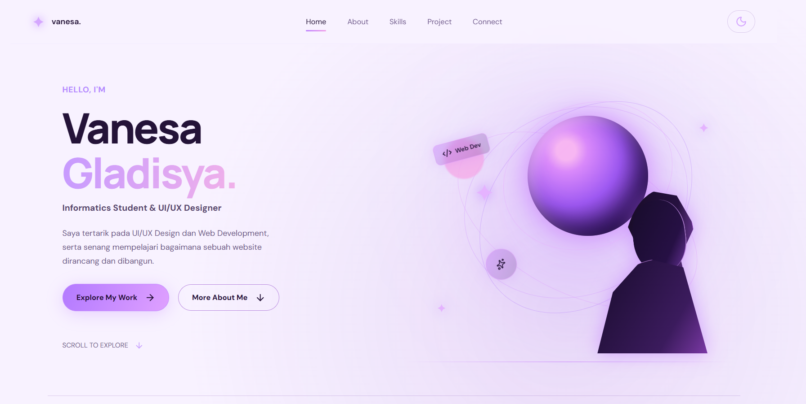
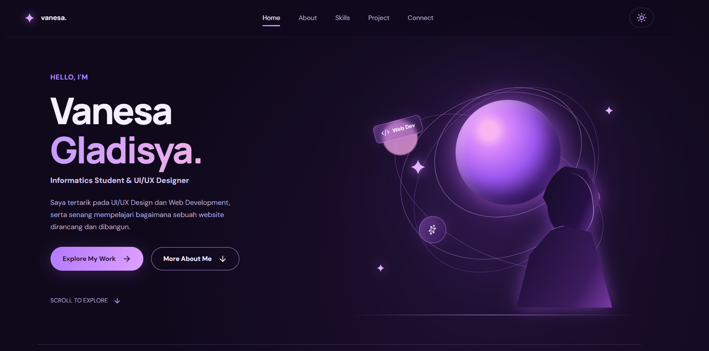
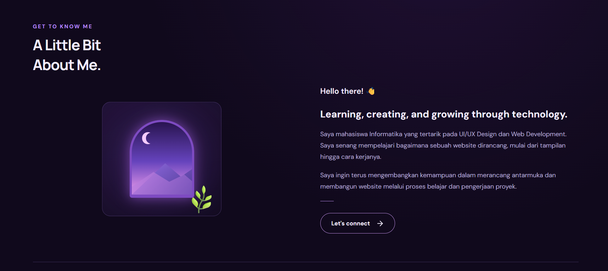
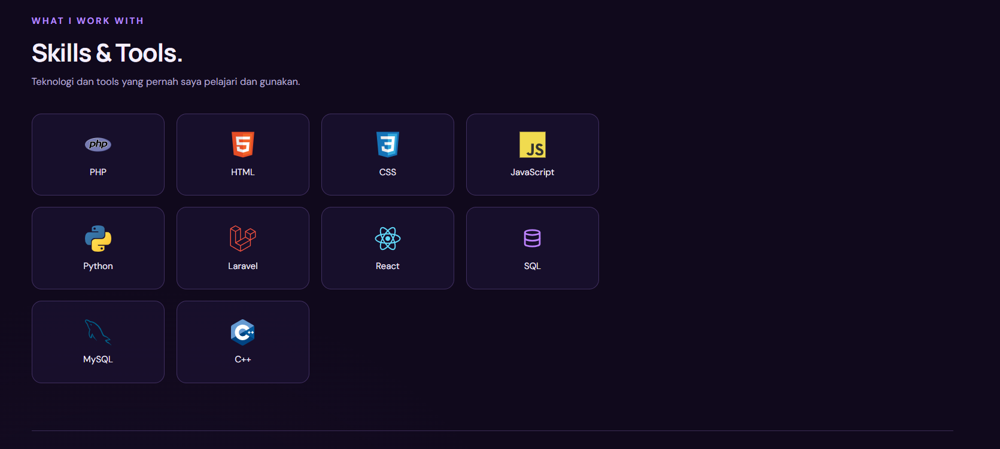
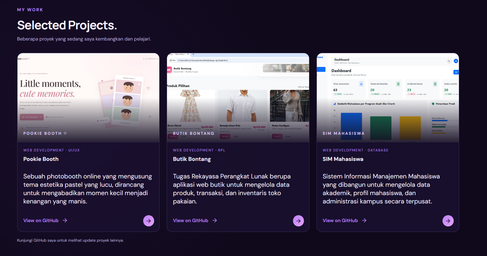
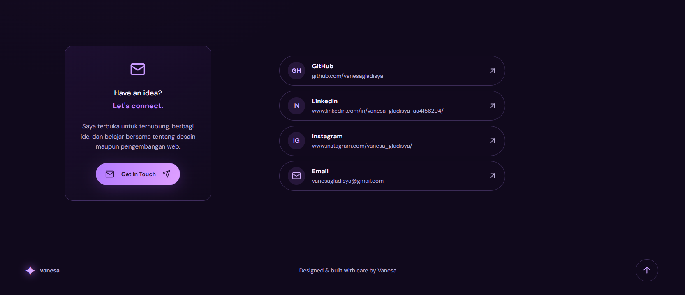

# Personal Portfolio Website - Vanesa Gladisya Mamanua

Project Ujian Tengah Semester (UTS) mata kuliah **Pemrograman Berbasis Framework**. Website ini merupakan portofolio pribadi yang menampilkan profil, keahlian (skills), dan proyek-proyek yang telah dikerjakan.

##  Deskripsi Project

Website portofolio ini dikembangkan menggunakan React JS dan Vite dengan mengusung tema antariksa (*space theme*). Desain menggunakan mode gelap (*dark mode*) dengan aksen warna ungu dan pink, serta dilengkapi fitur pergantian tema ke mode terang (*light mode*).

Website dirancang secara responsif agar dapat diakses dengan nyaman melalui perangkat desktop, tablet, maupun smartphone.

##  Fitur Utama

1. **Responsive Design** – Tampilan menyesuaikan ukuran layar desktop, tablet, dan smartphone.
2. **Dark & Light Mode** – Fitur pergantian tema menggunakan React State.
3. **Smooth Scroll Navigation** – Navigasi antarbagian Home, About, Skills, Project, dan Connect dengan efek scroll halus.
4. **CSS Animation** – Ilustrasi pada Hero Section berupa planet, orbit, dan bintang dibuat menggunakan CSS.
5. **GitHub Integration** – Kartu proyek dilengkapi tautan menuju repository GitHub terkait.

##  Teknologi yang Digunakan

| Teknologi | Keterangan |
|---|---|
| React JS | Library utama untuk membangun antarmuka |
| Vite | Build tool dan development server |
| Vanilla CSS3 | Styling menggunakan Custom Properties, Flexbox, dan CSS Grid |
| Lucide React | Library ikon |
| Google Fonts | DM Sans dan Manrope |

##  Instalasi dan Menjalankan Project

Pastikan Node.js dan Git telah terinstal di komputer.

### 1. Clone Repository

```bash
git clone https://github.com/vanesagladisya/portofolio.git
```

### 2. Masuk ke Direktori Project

```bash
cd portofolio
```

### 3. Install Dependencies

```bash
npm install
```

### 4. Jalankan Development Server

```bash
npm run dev
```

### 5. Buka Website

Buka browser dan akses alamat berikut:

```text
http://localhost:5173
```

Jika Vite menampilkan alamat yang berbeda di terminal, gunakan alamat tersebut.

## 📸 Dokumentasi Website

### 1. Home – Light Mode



### 2. Home – Dark Mode



### 3. About



### 4. Skills



### 5. Projects



### 6. Connect



---

Dibuat oleh **Vanesa Gladisya Mamanua** 
